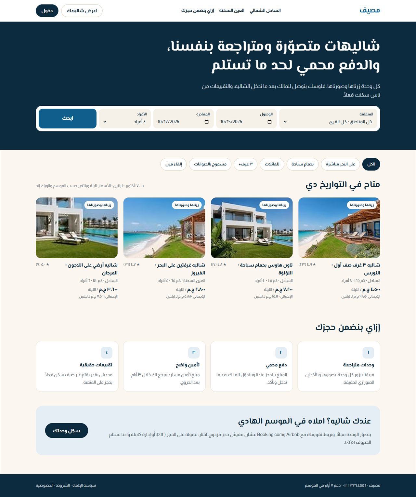
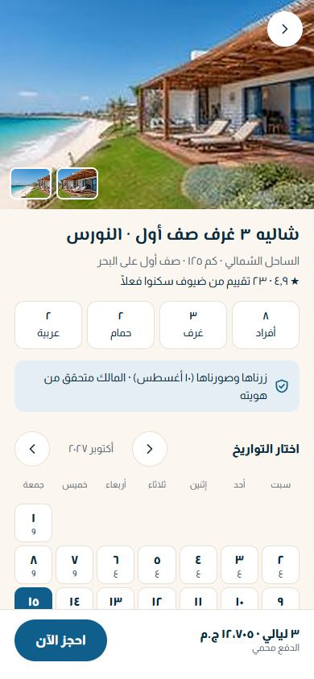
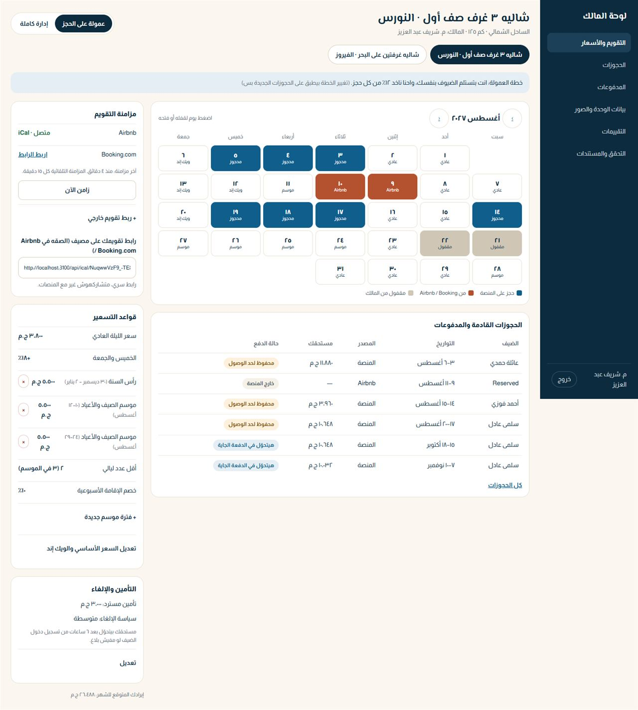
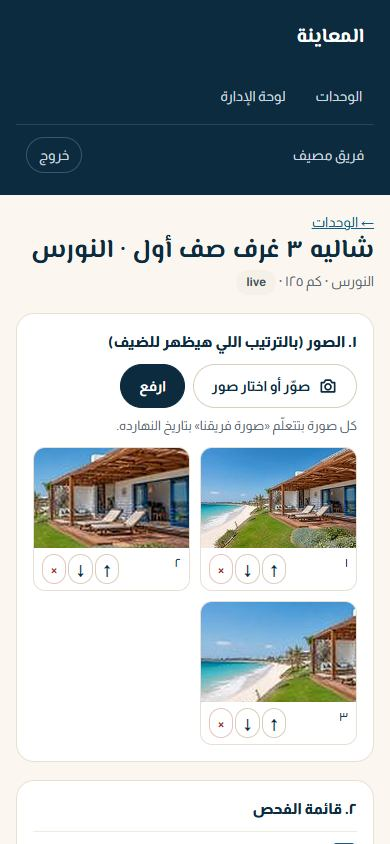

# مصيف · Chalet booking marketplace (North Coast & Ain Sokhna)

**Live demo:** https://chalet-marketplace.vercel.app (demo logins below; the demo data resets every day)

A trust-first, two-sided marketplace for summer chalets:
- Every unit is visited and photographed by our team.
- Guest money is held until check-in.
- Only real guests can review.
- Owners sync Airbnb and Booking.com calendars over iCal, so there are no double bookings.

```bash
npm install
npm run dev     # http://localhost:3000 — demo data is created on first run
npm test        # 37 tests: pricing, availability/turnovers, 20-way concurrency, iCal, payments, payouts, policies, deposits, issues, isolation
npm run lint    # TypeScript strict
```

| Page | URL |
|---|---|
| Search | `/` |
| Chalet page (open it at 390px) | `/chalets/nawras-3br-frontline?in=2027-08-17&out=2027-08-20` |
| Owner dashboard | `/login` → `sherif@masyaf.example` / `Masyaf#Owner2026` (commission plan) · `dalia@masyaf.example` / `Masyaf#Owner2026` (managed) |
| Admin | `admin@masyaf.example` / `Masyaf#Admin2026` |
| Inspector (phone) | `inspector@masyaf.example` / `Masyaf#Inspect2026` |

The demo logins are fictional and live only in `src/market/seed.ts` and this README.

**Demo walk-through:**
1. Book a chalet and pay on the sandbox Paymob page.
2. On the trip page, tap «استلمت الشاليه» (demo mode allows it early). The owner payout becomes releasable.
3. As admin, transfer the payout batch.
4. Add an event in **محاكي Airbnb**, then press **زامن الآن** in the owner dashboard. The dates get blocked.
   Delete the event and sync again, and they're freed.

Docs: [ARCHITECTURE](docs/marketplace/ARCHITECTURE.md) · [COMPLIANCE](docs/marketplace/COMPLIANCE.md) ·
[INSPECTOR-GUIDE](docs/marketplace/INSPECTOR-GUIDE.md) · [CHANGELOG](docs/marketplace/CHANGELOG.md) · [TODO](docs/marketplace/TODO.md)

## Screenshots





